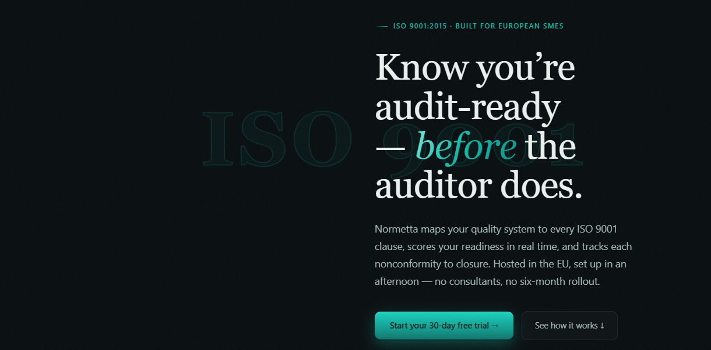

# Normetta

**ISO 9001:2015 quality management & audit platform for European SMEs.**

Normetta maps a quality system to every ISO 9001 clause, scores readiness in real
time, and tracks each nonconformity through to closure — EU-hosted, set up in an
afternoon.

| | |
|---|---|
| Live app | https://www.normetta.com |
| Backend base URL | `https://www.normetta.com/_/backend/api` |
| Stack | Next.js 14 · Express · Prisma 6 · PostgreSQL (Supabase) · Vercel |

---

## What it does

| Capability | Where it lives |
|---|---|
| Clause-by-clause self-assessment against ISO 9001:2015 | `assessments/`, `assessmentService.ts`, `responseService.ts` |
| Readiness scoring and management dashboards | `dashboard/`, `dashboardService.ts` |
| Nonconformity register with severity and status workflow | `non-conformities/`, `nonConformityService.ts` |
| Corrective actions with owners and verification | `actions/`, `correctiveActionService.ts` |
| AI root-cause assistant for findings | `rootCauseAgentService.ts` |
| Evidence upload and linkage to clauses | `evidenceService.ts` |
| PDF/report export for auditors | `reportService.ts` |
| Multi-tenant orgs, invites, roles, GDPR export/erasure | `orgInviteService.ts`, `gdprService.ts` |

---

## Repo layout

```
Normetta/
├── backend/               # Express + TypeScript API (Vercel serverless)
│   ├── prisma/            # Prisma schema + migrations (run manually)
│   └── src/
│       ├── controllers/   # Thin request handlers
│       ├── proxy/         # authProxy.ts (withAuth), validationProxy.ts (Zod)
│       ├── routes/        # Express routers
│       ├── services/      # Business logic
│       └── types/         # Enums + shared types
├── frontend/              # Next.js 14 App Router
│   └── src/
│       ├── app/           # (auth), (dashboard), onboarding, join routes
│       ├── components/    # UI + landing/ marketing page
│       └── lib/           # api.ts (axios client), Zustand stores
├── shared/                # Types shared by frontend and backend
├── docs/                  # Setup, API, deployment, legal, RLS runbooks
└── supabase/migrations/   # Database migrations
```

The marketing landing page is part of the Next.js app:
`frontend/src/components/landing/LandingPage.tsx`, rendered by
`frontend/src/app/page.tsx`, with styles scoped under `.lp` in `landing.css`.

---

## Getting started

```bash
npm install                       # workspace install (backend, frontend, shared)
npm run dev                       # backend + frontend concurrently
```

Environment: create `backend/.env` (database URLs, `JWT_SECRET`,
`TURNSTILE_SECRET_KEY`) and `frontend/.env.local` from
[`frontend/.env.example`](frontend/.env.example). See
[`docs/SETUP.md`](docs/SETUP.md) for the full walkthrough.

### Before every commit

```bash
cd backend  && npx tsc --noEmit
cd frontend && npx tsc --noEmit
```

### Other commands

| Command | Purpose |
|---|---|
| `npm run build` | Build all workspaces |
| `npm run test` | Run workspace test suites |
| `npm run lint` | Lint all workspaces |
| `cd backend && npx prisma generate` | Regenerate the Prisma client after schema changes |
| `cd backend && npx prisma studio` | Inspect the database |

---

## Conventions that bite

- **Migrations are never auto-run.** `prisma migrate deploy` is deliberately kept
  out of the Vercel build. Write the SQL into
  `backend/prisma/migrations/<timestamp>_<name>/migration.sql` and run it manually
  in the Supabase SQL Editor.
- **Zod enums are UPPERCASE.** `'QUALITY_MANAGER'`, `'MAJOR'`, `'OPEN'` — the
  validation layer rejects lowercase.
- **Auth is a proxy, not middleware.** Wrap handlers with `withAuth` from
  `backend/src/proxy/authProxy.ts`; the JWT payload is on `(req as any).user`.
- **camelCase in Prisma, snake_case in SQL.** Always add `@map()` when they differ.
- **Never hardcode the backend URL.** It is `/api` in dev and `/_/backend/api` in
  production, resolved through `frontend/src/lib/api.ts`.

---

## Documentation

| Document | Contents |
|---|---|
| [`docs/SETUP.md`](docs/SETUP.md) | Local development setup |
| [`docs/API.md`](docs/API.md) | Endpoint reference |
| [`docs/DEPLOYMENT.md`](docs/DEPLOYMENT.md) | Vercel + Supabase deployment |
| [`docs/RLS_OPERATOR_RUNBOOK.md`](docs/RLS_OPERATOR_RUNBOOK.md) | Row-level security operations |
| [`docs/CODE_REVIEW_CHECKLIST.md`](docs/CODE_REVIEW_CHECKLIST.md) | Review checklist |
| [`CLAUDE.md`](CLAUDE.md) | Working agreement for AI-assisted changes |

---

## The product



---

## Architecture

From the browser down to the database: the Next.js surfaces call a single API
client, which reaches the Express API; routes dispatch into the quality-workflow
services, and those read and write the application database or hand work off to
email delivery.


